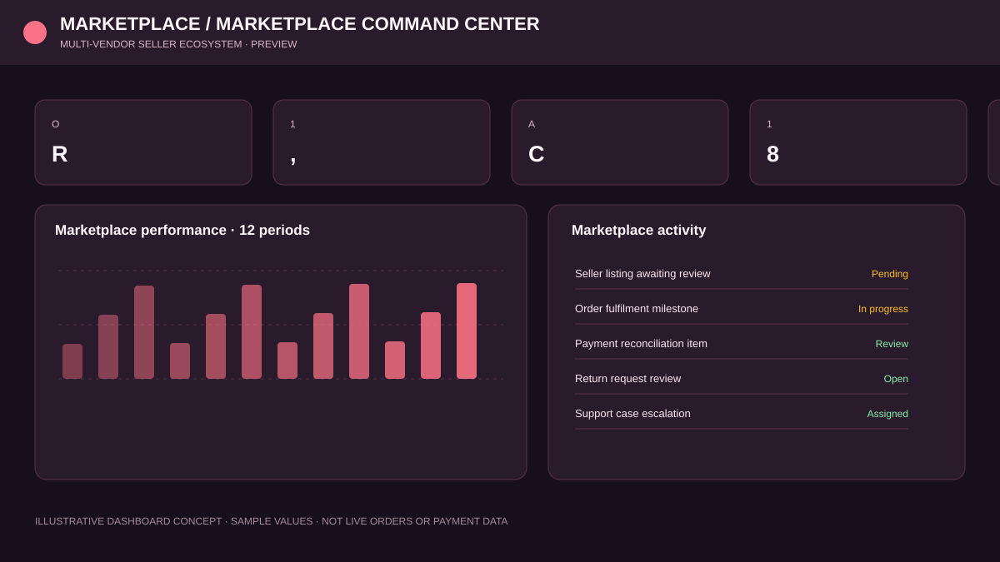
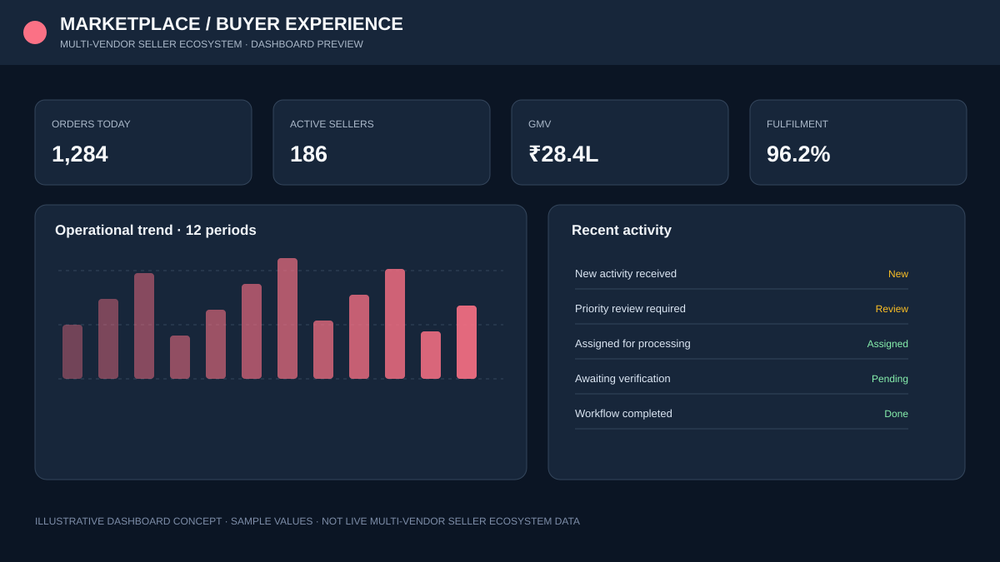
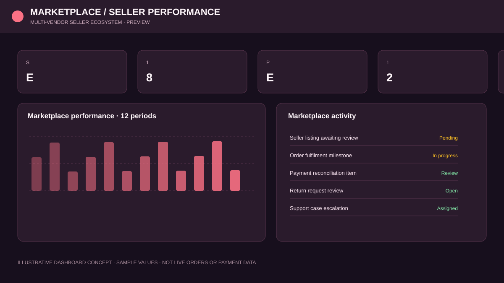
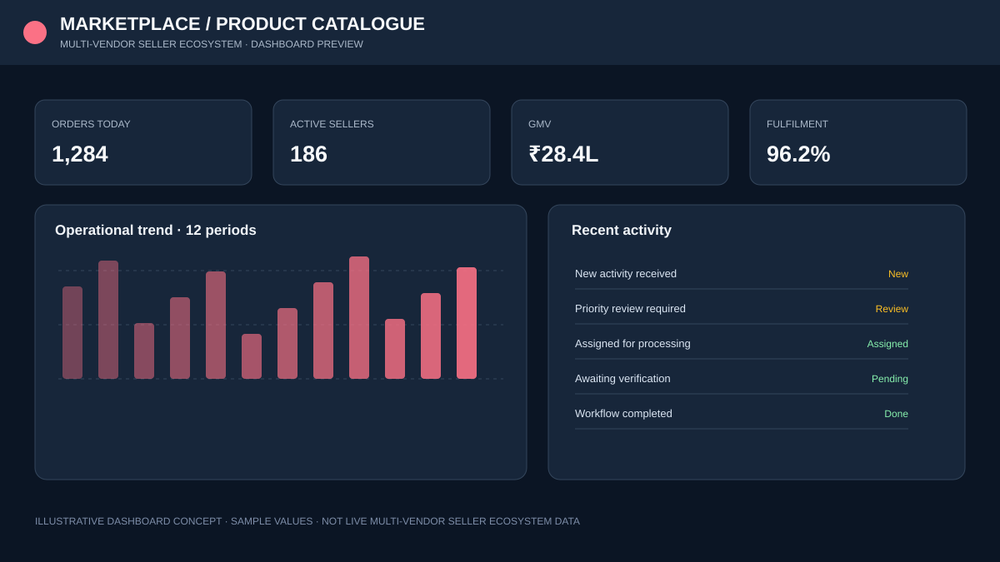
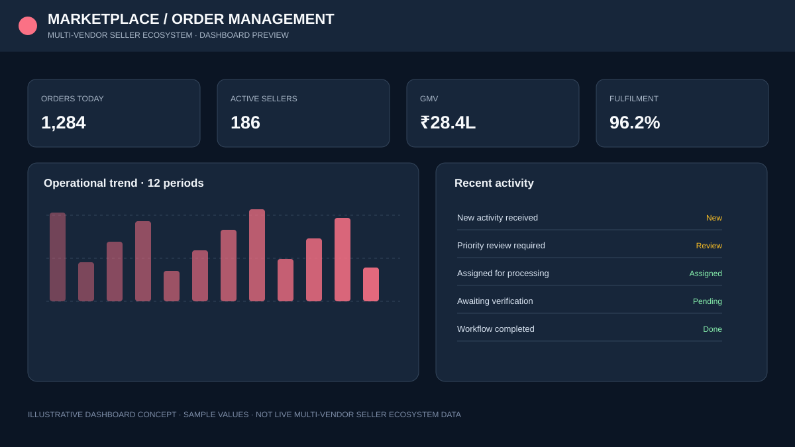
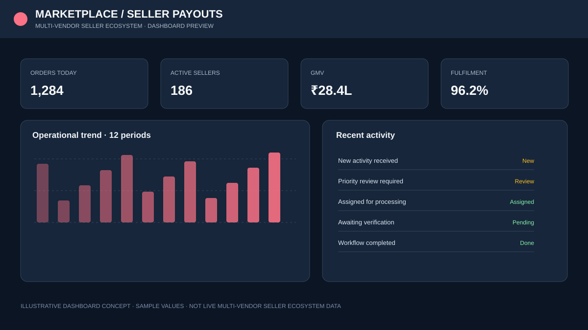
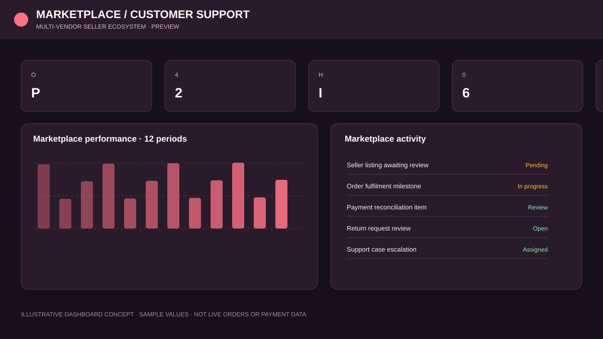
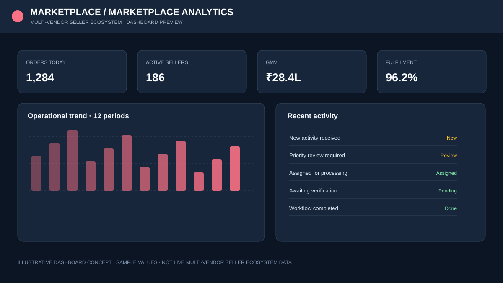

# Multi-Vendor Marketplace & Seller Operations Platform

A full-stack e-commerce portfolio project demonstrating buyer, seller, logistics, finance and platform-administration workflows.

> **Project status:** Portfolio demonstration and active development. It is not a production marketplace or a payment service. Use synthetic accounts and test data only.

## Live demo

| Component | URL |
|---|---|
| Frontend | https://marketplace-ecosystem.vercel.app |
| Backend API | https://enterprise-ai-powered-multi-vendor.onrender.com |
| Source | https://github.com/matiur25580/Enterprise-AI-Powered-Multi-Vendor-Marketplace-Seller-Ecosystem-Command-Center |

The hosted services may sleep or change configuration; availability is not guaranteed.

## Product workflows

### Buyer

- Browse and search multi-seller products.
- Manage cart, wishlist and recently viewed products.
- Follow order status and submit reviews.
- View coupons, wallet and loyalty-related demo workflows.

### Seller

- Manage products and stock.
- Review orders, sales summaries and customer feedback.
- Configure promotions and coupons.
- Submit KYC information for administrative review.

### Logistics partner

- Review assigned deliveries and update shipment status.
- Coordinate delivery notes and warehouse handoffs.

### Finance

- Review platform commission and seller payout workflows.
- View settlement-oriented summaries.

### Platform administrator

- Review users, seller KYC submissions and platform settings.
- Manage featured products and announcements.
- Inspect activity-oriented dashboard views.

## Intelligence features

The project includes recommendation, sales-forecast and suspicious-order indicators. Treat these as portfolio/demo decision-support features; no independently validated predictive accuracy, fraud-detection performance or production AI model is claimed.

## Technology

| Layer | Stack |
|---|---|
| Frontend | React, Vite, React Router |
| Backend | Node.js, Express 5 |
| Database | MongoDB, Mongoose |
| Authentication | JWT, bcryptjs, email OTP |
| Realtime | Socket.IO dependency |
| Documents | PDFKit |
| Email | Nodemailer |

## Architecture

```text
Buyer / Seller / Logistics / Finance / Admin workspaces
                         |
                         v
                   React client
                         |
                         v
                    Express API
                    /         \
              Auth routes    Shop routes
                    \         /
                     MongoDB
```

## Run locally

### Requirements

- Node.js and npm
- MongoDB instance
- Email provider configuration for email-dependent workflows

### 1. Backend

```bash
cd server
npm install
```

Create `server/.env`:

```dotenv
MONGO_URI=mongodb://127.0.0.1:27017/marketplace_demo
JWT_SECRET=replace-with-a-unique-random-secret
PORT=5000
```

Add email-provider variables only when using the corresponding email workflows. Start the API:

```bash
npm start
```

Health endpoint: `GET /api/health`.

### 2. Frontend

```bash
cd client
npm install
```

Create `client/.env`:

```dotenv
VITE_API_URL=http://localhost:5000
```

Start Vite:

```bash
npm run dev
```

## Engineering status and production gaps

The active Express entry point now uses a comma-separated `CLIENT_URL` allowlist for CORS, rejects unconfigured browser origins, applies baseline security response headers, limits JSON request bodies to 1 MB, returns consistent 404/error responses, and fails fast when `MONGO_URI` is missing or the database connection fails. The backend package no longer advertises a placeholder test command; automated tests still need to be implemented. Before production use:

- Restrict CORS to explicit frontend origins and add appropriate security headers.
- Verify server-side authorization and seller/buyer ownership for every sensitive operation.
- Add rate limiting, request validation, secure upload controls and structured error handling.
- Add automated unit, integration and end-to-end tests.
- Integrate a real payment provider only with idempotent payment, refund, webhook-signature and reconciliation controls.
- Add audit coverage, operational monitoring and documented backup/restore procedures.

Do not enter real payment credentials or customer personal data into the demo.

## Maintainer

**Matiur Rahaman** · [GitHub](https://github.com/matiur25580)


## Dashboard Gallery

Explore 12 illustrative marketplace workspaces for command-center health, buyer experience, seller performance, catalogue, orders, inventory, shipping, payments, payouts, returns, customer support and marketplace analytics. All metrics are sample values for UI illustration, not live transactions, settlement balances or seller records.

### 01. Marketplace Command Center

Marketplace activity, order health, seller performance and fulfilment status.



### 02. Buyer Experience

Buyer accounts, discovery activity, cart conversion and order journey.



### 03. Seller Performance

Seller onboarding, catalogue health, order fulfilment and seller ratings.



### 04. Product Catalogue

Product approvals, inventory availability, category mix and listing quality.



### 05. Order Management

Order states, payment status, fulfilment progress and exception handling.



### 06. Inventory & Stock

Stock levels, reservations, replenishment signals and inventory movement.


### 07. Shipping & Logistics

Dispatch queue, carrier handoff, delivery milestones and tracking exceptions.


### 08. Payments & Reconciliation

Payment intents, settlement status, refunds and reconciliation exceptions.


### 09. Seller Payouts

Seller earnings, payout eligibility, pending settlements and payout history.



### 10. Returns & Refunds

Return requests, inspection status, refund references and resolution time.


### 11. Customer Support

Support queue, order-related issues, response times and customer satisfaction.



### 12. Marketplace Analytics

Revenue trends, category performance, seller growth and conversion analytics.


